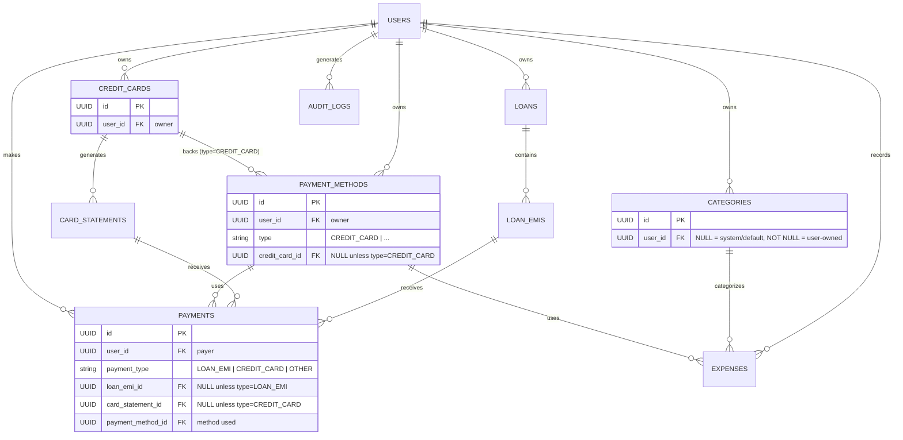

# MoneyPilot Entity Relationship Diagram

## Explanation

### 1. User ownership
`USERS` is the root tenant of the data model. Every primary resource is owned by a
user: loans, credit cards, expenses, payment methods, categories, payments, and audit
logs all hang off `USERS` through a one-to-many relationship. This keeps the data
scoped per user and makes authorization checks straightforward.

### 2. Loan → EMI relationship
A `LOANS` record represents a borrowed principal, and each loan is broken down into a
schedule of installments. `LOANS ||--o{ LOAN_EMIS` means one loan contains many EMIs
(equated monthly installments), with each EMI row capturing a single due amount and due
date within that loan's repayment plan.

### 3. Credit Card → Statement relationship
A `CREDIT_CARDS` record represents a card held by the user. `CREDIT_CARDS ||--o{
CARD_STATEMENTS` means each card generates many statements over time, one per billing
cycle, where a statement captures the balance, minimum due, and due date for that cycle.

### 4. Expense → Category relationship
An `EXPENSES` row records a single spend. `CATEGORIES ||--o{ EXPENSES` means one category
classifies many expenses, letting the user group spending (for example, groceries or
travel). An expense also references the `PAYMENT_METHODS` used to pay for it.

### 5. Payment → Loan EMI / Credit Card Statement relationship
A `PAYMENTS` row records money paid toward an obligation. The same payment table serves
two kinds of obligations:
- `LOAN_EMIS ||--o{ PAYMENTS` — a loan EMI receives one or more payments.
- `CARD_STATEMENTS ||--o{ PAYMENTS` — a card statement receives one or more payments.

Each payment also records the `PAYMENT_METHODS` used and the `USERS` who made it.

### 6. Why payments use explicit foreign keys instead of polymorphic references
`PAYMENTS` carries two explicit, nullable foreign-key columns:
- `PAYMENTS.loan_emi_id` → `LOAN_EMIS`
- `PAYMENTS.card_statement_id` → `CARD_STATEMENTS`

A single payment points at a loan EMI or a card statement by populating the matching
column and leaving the other null. This explicit modeling is preferred over a
polymorphic `reference_type` / `reference_id` pair because:

- **Referential integrity** — real foreign keys let the database enforce that a payment
  points at a row that actually exists. A polymorphic `reference_id` cannot have a
  foreign-key constraint, so dangling references become possible.
- **Query clarity and performance** — joining `PAYMENTS` to `LOAN_EMIS` or
  `CARD_STATEMENTS` is a direct, indexable join. Polymorphic references force
  type-conditional joins that are harder to optimize and index.
- **Type safety** — each column has a known target table, so the schema is
  self-documenting and ORM mappings stay simple and strongly typed.
- **Easier evolution** — adding a new payable target is a new explicit column with its
  own constraint, keeping each relationship independently validated rather than
  collapsing everything into an untyped identifier.

### 7. Payment method → Credit card relationship
`PAYMENT_METHODS` carries a nullable `credit_card_id` foreign key:

- `PAYMENT_METHODS.credit_card_id` → `CREDIT_CARDS.id`

When a payment method has `type = CREDIT_CARD`, `credit_card_id` identifies the exact
card behind it. This lets an expense (which already points at a `PAYMENT_METHODS` row)
resolve the precise credit card used without duplicating `credit_card_id` directly on
`EXPENSES`. Business rules:

- If `type = CREDIT_CARD`, then `credit_card_id` **must** be populated.
- For every non-credit-card type, `credit_card_id` **must** be `NULL`.

### 8. Categories: system/default vs. user-owned
`CATEGORIES.user_id` is nullable, and its nullability encodes ownership:

- `categories.user_id IS NULL` → a **system/default** category shared across all users.
- `categories.user_id IS NOT NULL` → a **user-owned** category belonging to that user.

`user_id` is intentionally **not** mandatory so the system can seed shared default
categories alongside each user's custom ones.

### 9. Partial payments against EMIs and statements
Neither `PAYMENTS.loan_emi_id` nor `PAYMENTS.card_statement_id` is unique, so a single
loan EMI or card statement can receive multiple payments. An obligation is settled when
the sum of its valid payments equals its amount:

- Loan EMI = ₹25,000, Payment 1 = ₹10,000, Payment 2 = ₹15,000 → EMI becomes `PAID`
  when total valid payments (₹25,000) equal the EMI amount.
- Credit-card statement = ₹50,000, Payment 1 = ₹20,000, Payment 2 = ₹30,000 →
  statement becomes `PAID` when total payments (₹50,000) equal the statement amount.

### 10. Payment types
`PAYMENTS.payment_type` is one of:

- `LOAN_EMI` — `loan_emi_id` populated, `card_statement_id` NULL.
- `CREDIT_CARD` — `card_statement_id` populated, `loan_emi_id` NULL.
- `OTHER` — both `loan_emi_id` and `card_statement_id` are NULL.
